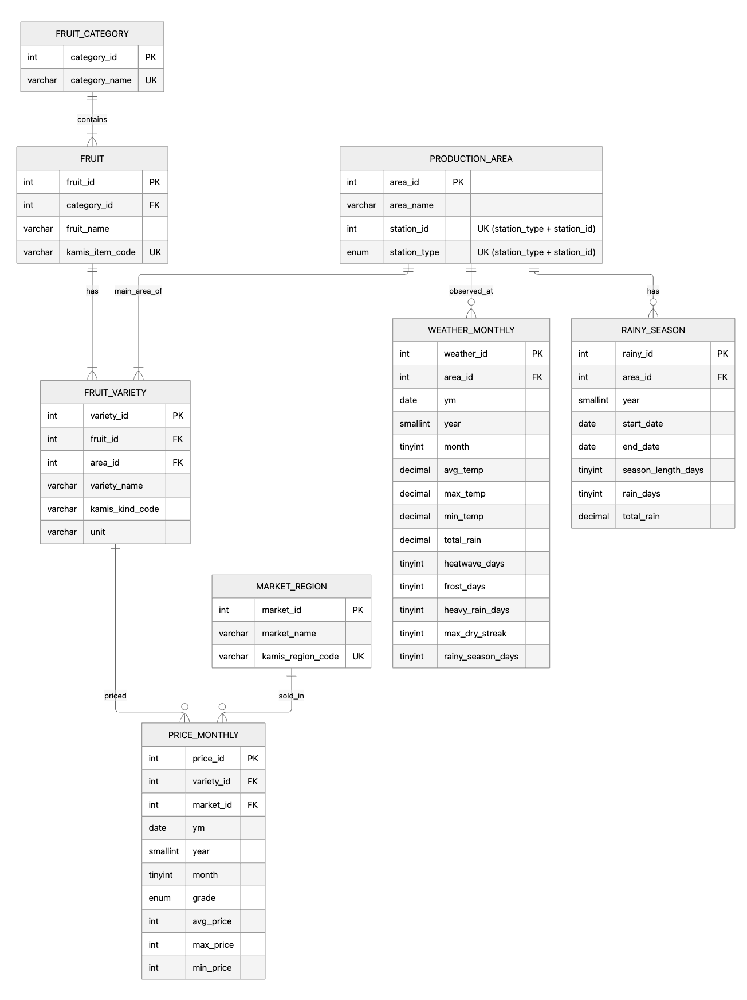
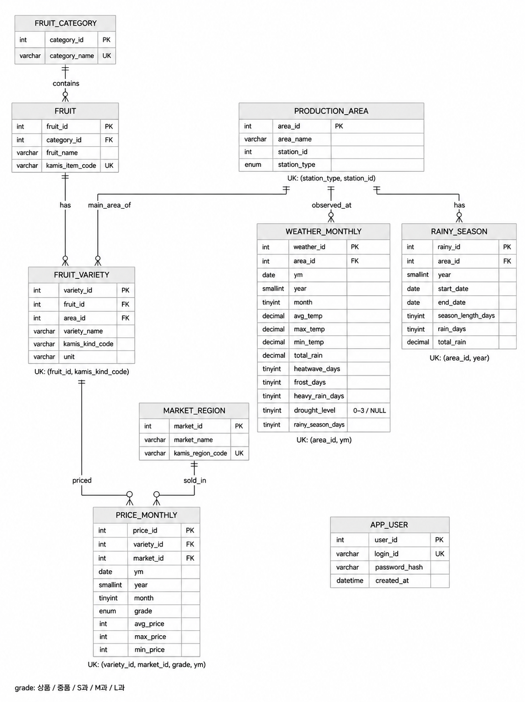

# ERD 변경 전·후

왼쪽은 사용자가 제공한 2026-11-15 품종별 주산지 ERD 원본, 오른쪽은 2026-11-23 SQL에 맞춘 보고서용 수정 이미지입니다. 원본 이미지는 그대로 보관했습니다.

| 변경 전 | 변경 후 |
| --- | --- |
|  |  |

## 반영 내용

- `WEATHER_MONTHLY.max_dry_streak` → `drought_level`: SPI3 기반 0~3 단계, 미확보는 NULL.
- 회원 테이블 `APP_USER` 추가: user_id, login_id, password_hash, created_at. 다른 테이블과 FK 관계는 없음.
- 누락돼 있던 복합 UNIQUE 제약을 각 테이블 아래에 명시.
- 가격 등급 상품·중품·S과·M과·L과 표기.
- 기존 표 형식과 상대적 배치, 품종별 주산지 연결을 유지. FK 관계를 부모 1 : 자식 0..N으로 정리.

## 이미지 검토

`sql/dbcreate.sql`의 테이블 9개, 컬럼 55개, FK 7개와 대조했습니다. 그림의 타입은 기존 이미지처럼 길이·정밀도·UNSIGNED를 생략한 요약 표기이며 정확한 타입과 제약은 SQL을 기준으로 합니다. 뷰는 물리 테이블로 그리지 않았으며 [ERD 설명](ERD.md)에 연결 방식을 정리했습니다.
