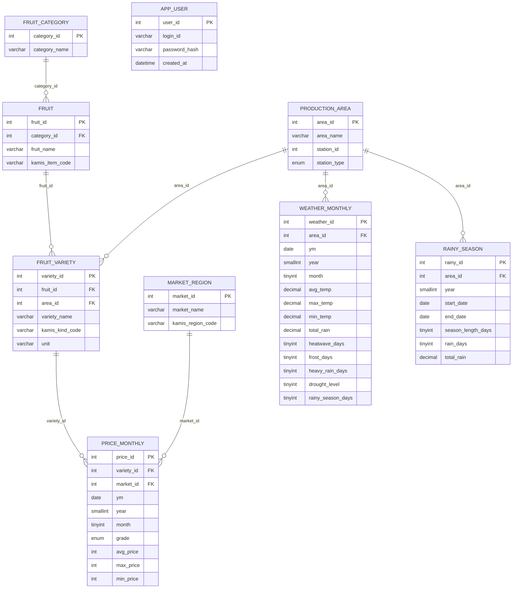

# 최종 DB 구조 — 가뭄 단계 반영

`sql/dbcreate.sql` 기준 테이블 9개와 뷰 1개입니다. 회원 테이블은 독립적이며 품종별 대표 주산지 연결을 유지합니다.

## 주요 제약과 뷰

- 과일군 이름, KAMIS 품목코드, 소비도시 코드는 각각 고유합니다.
- 관측소: `(station_type, station_id)` 고유.
- 품종: `(fruit_id, kamis_kind_code)` 고유.
- 가격: `(variety_id, market_id, grade, ym)` 고유. 등급은 상품·중품·S과·M과·L과.
- 월별 기상: `(area_id, ym)` 고유. 장마 기간: `(area_id, year)` 고유.
- 회원: `login_id` 고유. 모든 FK는 ON DELETE/UPDATE RESTRICT입니다.
- `ym`은 월 1일이며 `year`, `month`와 일치해야 합니다.
- `WEATHER_MONTHLY.drought_level`: SPI3 기반 단계 0~3 또는 NULL. 연속 건조 일수가 아닙니다. 단계별 명칭과 경계값은 정제 담당자의 기준에 따르며 여기서 새로 정의하지 않습니다.
- 폭염·저온·집중호우·장마 일수는 기존처럼 해당 월 일수 이내로 검사합니다.
- `v_price_weather`: 가격 → 품종 → 품목·과일군, 소비도시, 품종의 대표 주산지를 연결하고 같은 주산지·월의 날씨를 LEFT JOIN합니다. `max_dry_streak` 대신 `drought_level`을 노출합니다. 날씨 미확보 시 NULL입니다.

## 적용 방법

- 새 DB: 수정된 `sql/dbcreate.sql` 실행.
- 이미 만든 DB: 백업 후 `sql/dbalter_drought_level.sql` 실행. 기존 자료를 삭제하지 않습니다. 기존 건조 일수에 값이 있으면 의미가 달라 자동 변환하지 않고 중단합니다.
- DDL은 자동 커밋되므로 적용 도중 뷰 변경에서 실패하면 원인을 해결한 뒤 변경 SQL을 재실행합니다. 적용 중 다른 쓰기 작업은 멈춥니다.
- 시원님 브랜치의 `scripts/build-dbinsert.php` 및 생성되는 `sql/dbinsert.sql`도 컬럼명을 `drought_level`로 맞춰야 합니다. 이전 컬럼명이 남은 INSERT는 새 스키마에서 실행할 수 없습니다.
- 기존 통합본의 가뭄 값은 NULL입니다. 컬럼 변경만으로 가뭄 자료가 채워지지 않습니다. 실제 정제본을 관측소·월로 매핑하여 0~3 값을 적재하고 미확보 값은 NULL로 유지합니다.

## 검증

XAMPP MariaDB 10.4.28의 별도 테스트 DB에서 시원님 통합본(가격 5,386행, 기상 1,056행, 장마 88행)의 마이그레이션과 행 수 보존, 반복 실행, 신규 스키마 적재, 가뭄 범위 및 기존 일수 제약, 뷰 조회를 확인했습니다. 신규 스키마 테스트에서는 통합 SQL의 컬럼명만 임시로 변경했으며 실제 팀 통합 파일은 변경하지 않았습니다. 기존 가뭄 컬럼에 값이 있으면 변경 전에 중단되는 것도 확인했습니다.
